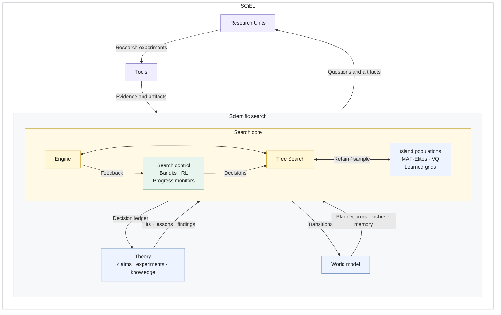
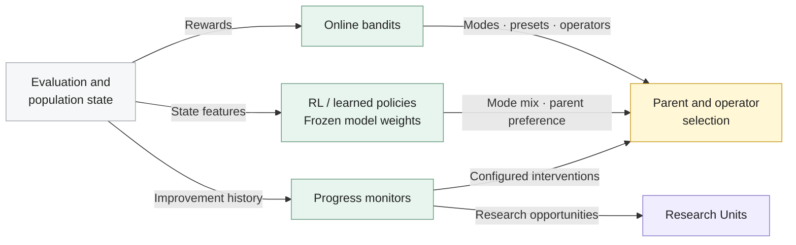

# SCiEL

**Evolutionary program search that develops its own research methods.**

[](https://github.com/Doldrums/sciel/releases/tag/v0.15.0)
[](#quick-start)
[](#tasks)

SCiEL — **Scientific Closed-Loop Evolution** — studies a specific question:
**can a search system improve the methods it uses to make further progress?**

The engine evolves programs against an executable task contract. Every search
decision is randomized and logged with its probability; a theory of the search,
tested anytime-validly on that log, and a learned world model of the search shape
later decisions and proposals. Persistent research cells can also
write tools, run numerical experiments, retain intermediate state, and share
methods across branches of the search.

This creates two histories: **the lineage of solutions** and **the lineage of
methods used to obtain them**. A tool developed while investigating one candidate
can survive that candidate and later be used on another branch.

[Quick start](#quick-start) · [Architecture](#architecture) · [Research cells](#research-cells)
· [Tasks](#tasks) · [Empira](#inspect-runs-in-empira) · [Contributing](CONTRIBUTING.md)

## Architecture

The architecture builds outward from an **Engine + Tree Search** core.
**Theory + World Model** form the scientific search loop around it.
**Research Units + Tools** extend that loop with persistent investigations and
reusable methods.



**Tree Search** denotes evolutionary branching and selection over program
lineages and island populations. **Research Units** are persistent research cells.
The decision ledger feeds the theory and the world model; proven claims, findings
and lessons reach later decisions only as randomized arms judged by the same ledger. Units create, run and revise tools, returning observations and
saved artifacts to the scientific loop. Tool-produced candidates pass through the
engine's source validation and ordinary task evaluation.

Independent research continuations can be enabled so an open question progresses
without waiting for its island to be selected for another mutation.

**Bandits, RL and progress monitors** control how the search uses its population.
Profiles select compatible combinations of these control paths:



The **operator bandit** selects a diff, rewrite, eligible repair or crossover.
**Mode and preset bandits** adjust parent-selection preferences; presets are an
alternative to the mode-controller path. **Learned policies** supply mode
probabilities through a mode MLP or parent preferences through the three-head
policy's promise head.
**Progress monitors** detect stagnation and, when enabled, intervene in search or
trigger research work. Population storage determines niches and candidate
retention separately from these policies.

| Capability | What it controls |
| --- | --- |
| **Population and diversity** | Island populations with MAP-Elites grids, learned descriptor grids, VQ niches, or other configured containers. Seeding, crossover and island creation are separate choices. |
| **Search decisions** | Parent and operator selection, mode mixtures and online bandits. Optional trained policies influence decisions using their saved model weights. |
| **Theory of search** | Randomized decisions with logged probabilities; anytime-valid claims, discriminating experiments, theorist strategies, and a knowledge pool of cell findings and lessons. |
| **Candidate novelty** | Run-wide SHA-256 and AST repeat detection, code-similarity context, and optional output-repeat checks. The registry survives eviction and checkpoint/resume. |
| **Research cells** | Persistent questions, tool revisions, saved artifacts, sequential experiments, background jobs and cross-island method exchange. |
| **Parallel execution** | Configured search workers and shared capacity limits for model requests, evaluators and research work. |
| **Provenance and recovery** | Append-only journals, saved model calls, task and source identities, checkpoints, request accounting and explicit recovery decisions. |

These capabilities are selected through configuration, with validated dependencies
and compatibility constraints. Online bandits update during a run; neural policies are
trained offline and loaded for inference. Enabling a trained policy does not start
an online neural-training loop.

See the [configuration defaults](src/sciel/config.py),
[maintained profiles](configs) and [engine modules](src/sciel/engine).

## Research cells

A research cell holds a question and its experimental history across generations
of candidate programs. It receives search context, available tools, prior
observations and references to saved candidate artifacts. Depending on the
profile, work can begin proactively, after a stagnation signal, or as a
continuation of an unfinished question.

| Stage | Recorded evidence |
| --- | --- |
| **Propose** | A concrete question, the selected tool or proposed source, and the decision the experiment is intended to inform. |
| **Execute and repair** | The exact tool revision, inputs, resource limits, outputs and failures. Explicitly returned and saved state can be used by a later invocation. |
| **Interpret and continue** | Measurements, their limitations, and a decision to revise the tool, run another experiment, submit a candidate or close the question. |
| **Independent replay** | A separate invocation of the assigned version, with its own execution record. |
| **Adopt** | A recipient trial and the resulting immutable revision history. |
| **Use again** | A later recorded invocation showing that the adopted method was actually reused. |

Observations enter subsequent generation context with their source and scope.
A candidate produced through a tool still goes through the ordinary task
validation path. Tool availability, successful execution, adoption and demonstrated
benefit have separate evidence: a release or an adoption event alone establishes
neither a quality improvement nor a better research process.

The implementation lives in [research_tools](src/sciel/research_tools) and
[methods](src/sciel/methods). Background execution, proactive work, independent
continuations and shared observations have separate configuration switches.

## Quick start

Requires **Python 3.11–3.14** on Linux or macOS.

```sh
pip install ./sciel-<version>-py3-none-any.whl   # from the latest release, see Releases
sciel
```

`sciel` with no arguments finds a model key (`ANTHROPIC_API_KEY` or `OPENROUTER_API_KEY`, or asks for one
once), takes the default profile and asks what to improve: the bundled circle-packing demo, a program of
yours, or a run to continue. Runs and generated tasks are kept in `./.sciel`.

**Your own problem** is one Python file with `solve()` and `score(result)`:

```python
def solve():                # the search rewrites this
    return [0.0, 0.0]

def score(result) -> float: # fixed during the search; higher is better, valid results score above 0
    x, y = result
    return 1 / (1 + (x - 1.7) ** 2 + (y + 0.7) ** 2)

def metrics(result):        # optional: numbers that describe how a result behaves, for the landscape maps
    return {"x": result[0], "y": result[1]}
```

```sh
sciel solve.py --budget 40
```

**From materials to a task.** Point `sciel task` at a folder with a description, papers, notebooks or data.
A model drafts `problem.py`, the seed is run and repaired if it fails, and an audit checks repeatability,
the noise floor and the headroom between the seed and a reference before the search starts:

```sh
sciel task ./materials --note "decode the order book, not forecast prices"
```

**Following a run.** The engine runs in the background. The terminal shows the score, islands, what the
search has learned, research cells and four views: the culture disk (islands as sectors, lineages as trees,
findings passed between islands as chords), the landscape in behaviour axes, the same programs in code
axes, and parent-versus-child edits against the noise band. The same views open as a local web page.

```sh
sciel watch .sciel/runs/circles-1        # terminal; w opens the page, p pauses, q leaves the run going
sciel web .sciel/runs/circles-1          # page only
sciel stop .sciel/runs/circles-1         # pause after the current step
sciel resume .sciel/runs/circles-1       # continue
```

A transient provider failure (rate limit, server error, timeout) pauses a parallel run and continues it;
the lost request is never resent and its unknown charge stays in the record.

From a source checkout, a mock model needs no credentials:

```sh
python3 -m venv .venv && .venv/bin/python -m pip install -e '.[tasks]'
.venv/bin/sciel run configs/smoke_mock.yaml --tasks-root ./tasks --budget 6 --watch none
```

`budget` counts successful evolutionary evaluations. Seeding and failed attempts are accounted
separately. Checkpoints bind task, source and execution identities; changing the engine can require
a fresh run.

### Configure a live experiment

Start with a [profile](configs), then explicitly choose the task, provider and
models, search budget, storage, research features and execution limits.
Chat-provider credentials come from the environment variable named by
`llm.api_key_env`. The Codex Responses transport also supports a configured
`codex_auth_file`. The two transports retain their own configuration and accounting.

| Optional dependency | Purpose |
| --- | --- |
| `tasks` | SciPy for the supplied numerical tasks. |
| `analysis` | Dataframe tools and sampled process-memory telemetry. |
| `board` | An optional Weights & Biases sink. |
| `dev` | Tests, schema validation and package builds. |

For example, install the numerical tasks with
`.venv/bin/python -m pip install -e '.[tasks]'`.

Learned profiles require external weights, normally under `../sciel-artifacts/`.
Configure `embed_grid_path` and `embed_axis_path`, or `embed_niche_path`.
Missing required artifacts stop startup; `embed_axis_path: null` explicitly
selects legacy projection. YAML `extends` paths are relative to the YAML file;
artifact paths are relative to the process working directory. Use absolute
artifact paths when launching from another location.

Research tools require `parallel_search`, `candidate_novelty`, a single provider
attempt (`llm.max_retries: 1`) and an immutable Docker image. A single search worker
is supported. See [integration validation](src/sciel/config_validation.py) and
[research-tool configuration](src/sciel/research_tools/config.py).

Native subprocess limits bound resources but do not isolate filesystem or network
access; container execution provides the separately configured isolation boundary.
An unlimited overall search still has bounded individual evaluations and tool
invocations.

## Tasks

The **v0.15.0** task bundle contains **11 packages**: ten research-task packages and
one internal test fixture. Each task defines its candidate interface, evaluator,
metrics and execution limits.

| Task | Search objective |
| --- | --- |
| [Circle packing](tasks/oe/circle_packing) | Maximize the sum of radii of 26 non-overlapping circles inside a unit square. A [stochastic seed variant](tasks/oe/circle_packing_seed) is also included. |
| [Heilbronn triangle](tasks/oe/heilbronn_triangle) | Place 11 points in an equilateral triangle to maximize the smallest triangle area over all triples. |
| [Function minimization](tasks/oe/function_minimization) | Search a specified two-dimensional objective. |
| [Hidden optimization](tasks/oe/function_minimization_oracle) | Minimize an unknown function with at most 50 oracle queries per instance, under a container-isolated protocol. |
| [Matrix multiplication tensor](tasks/oe/matmul_tensor) | Search tensor decompositions under rank and reconstruction checks. |
| [Discrete mathematics](tasks/math) | Beat-the-average, difference bases, edges versus triangles and square-free subset tasks. |
| [Toy quadratic](tasks/test/toy_quadratic) | An internal fixture for engine and evaluator contracts. |

Inspect the task's `task.yaml` and evaluator before comparing results. A normalized
score's denominator may be a fixed reference; it is not necessarily a current
record. Comparisons need compatible validity rules, tolerances and evaluation
conditions, alongside the models and resources used.

## Inspect runs in Empira

[Empira](https://github.com/Doldrums/arena) is the separate Arena application for
the research board and experiment workspace. SCiEL writes the native run evidence
that its observer reads: progress, candidate lineages, source changes, research
cells, tools, model calls and saved artifacts.

Follow [Empira's setup instructions](https://github.com/Doldrums/arena#quick-start),
then point its observer at your run directories from the Arena checkout:

```sh
python -m arena --root /absolute/path/to/sciel-runs
```

The engine's run directories remain the source of execution evidence. Provider
records distinguish known monetary charges from unavailable costs and requests
with unknown outcomes. Model tokens, evaluations, elapsed time and recorded
compute should be inspected together when assessing how a result was obtained.

## Releases

[SCiEL 0.15.0](https://github.com/Doldrums/sciel/releases/tag/v0.15.0) provides a wheel,
source distribution, separate task bundle, release manifest and SHA-256 checksums.
The wheel and source distribution contain the Python package; task packages and
configuration profiles are distributed separately through the task bundle and
repository checkout respectively.

After downloading the release assets:

```sh
python3 -m venv .venv
.venv/bin/python -m pip install './sciel-0.15.0-py3-none-any.whl[tasks]'
tar -xzf sciel-0.15.0-tasks.tar.gz
.venv/bin/sciel tasks list --tasks-root ./sciel-0.15.0-tasks/tasks
```

Use a checked-out profile or your own YAML configuration for `sciel run`, and pass
the extracted task root explicitly. Learned weights and credentials are supplied
by the deployment environment.

## Development and validation

```sh
.venv/bin/python -m pip install -e '.[tasks,dev,analysis]'
.venv/bin/python scripts/check_repository.py
.venv/bin/python -m pytest tests -q
.venv/bin/python -m build
git diff --check
```

Releases are built from tagged commits by the release workflow: wheel, source
distribution, task bundle and checksums.

| Path | Responsibility |
| --- | --- |
| [`engine/`](src/sciel/engine) | Search scheduling, population, generation, checkpoints and replay. |
| [`eval/`](src/sciel/eval) | Task loading, execution, evaluation and result certification. |
| [`causal/`](src/sciel/causal) | Decision ledger, off-policy estimators and anytime-valid inference. |
| [`theory/`](src/sciel/theory) | Claims, experiments, strategies, procedures and the knowledge pool. |
| [`swm/`](src/sciel/swm) | World model of the search, population learner, niches, archive and targets. |
| [`culture/`](src/sciel/culture) | Repertoire exported by one generation and inherited by the next. |
| [`evidence/`](src/sciel/evidence) | Measurement contracts and evidence codecs. |
| [`research_tools/`](src/sciel/research_tools) | Research cells, experimental execution and evidence delivery. |
| [`methods/`](src/sciel/methods) | Tool registries, resource budgets and method exchange. |
| [`components/`](src/sciel/components) | Selection, population containers and learned policies. |

Maintained files have a **500-line limit**, enforced by the repository check.
Experiment outputs, model weights and working notes live outside the source tree.
See [CONTRIBUTING.md](CONTRIBUTING.md) for implementation and verification rules.
