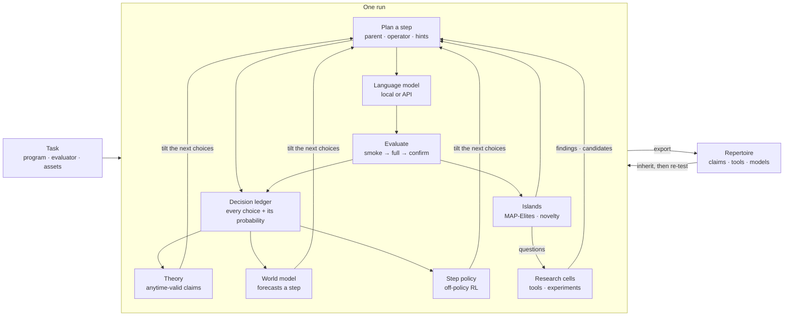

# SCiEL

**Recursive self-improvement through cultural transmission: it gets better at getting better.**

[](https://github.com/Doldrums/sciel/releases/tag/v0.18.0)
[](#quick-start)
[](#tasks)

SCiEL (*Scientific Closed-Loop Evolution*) is a step toward **recursive self-improvement** you can run on one
machine. Like AlphaEvolve, it gives a language model a program and a score, asks for changes, tests every change and
keeps what works. Unlike it, SCiEL also improves **the way it improves**:

- it writes **tools** and runs **experiments** about the problem, and keeps the ones that measure something;
- it learns **which of its own moves pay off**: which parent, which kind of edit, which hint;
- it hands what it learned to other branches of the search and to the **next run**, but only after a trial shows
  it helps.

We frame this as **cultural transmission**. Each branch of the search learns on its own; the culture is what gets
passed on, and only after the recipient tried it. A run therefore leaves two histories: the **lineage of solutions**,
and the **lineage of methods** that produced them. A tool written while studying one candidate can outlive it and be
reused on another branch, or in another run.

[Results](#results) · [See it run](#see-it-run) · [Quick start](#quick-start) ·
[How it works](#the-framework-at-a-glance) · [Components](#components) · [Models](#local-inference-or-an-api) ·
[Tasks](#tasks)

## Results

**With an open 27B model on one machine, SCiEL beat AlphaEvolve's bound on the third autocorrelation constant:
1.46138 against 1.4688, within 0.1% of the best known value.** On circle packing it matches the best known
packing to six digits.

Every number below is the task's own exact verifier, not a model's report. Budgets are evolutionary evaluations.

| Task | SCiEL | Reference | Setup |
| --- | --- | --- | --- |
| Third autocorrelation constant, \|f*f\| inside the max (minimize) | **1.46138** | AlphaEvolve 1.4688; best known 1.45999 | Qwen3.8-27B local, ~220 evaluations, ~10 h, exact rational scoring |
| Circle packing, 26 circles (maximize Σr) | **2.635977** with exact radii | AlphaEvolve 2.635; best known 2.635983 | Qwen3.8-27B local, 400 evaluations |
| Heilbronn, 11 points in a triangle (maximize the smallest area) | 0.03441 | AlphaEvolve 0.03653 | Qwen3.8-27B local, 400 evaluations |

Its circle packing reports 2.635988 under the task's 10⁻⁶ overlap tolerance; we
quote the value after recomputing the radii exactly.

What these numbers do not yet show: how much of the gain comes from SCiEL's own parts. That needs ablations on equal
budgets (full SCiEL, without research cells, without the learned planners, a plain evolutionary baseline), which come
next. Until then, read the table as what the system reached, not as what each component adds.

## See it run

`sciel watch` follows a run in the terminal; `sciel web` opens the same run as a local page. Both read the run's
journal, so they work on a live run or a finished one. Shown: the best run on the third autocorrelation constant
above, with a local Qwen3.8-27B.


| | |
| --- | --- |
|  |  |
| **Run.** Every attempt, why candidates fail, the idea and diff of each step. | **Maps.** The culture disk: islands as sectors, lineages as trees, findings passed between islands as chords. |
|  |  |
| **Engine.** How the islands were seeded and every attempt of every island. | **What it learned.** Findings of research cells and improvements, and where each was delivered. |

## Quick start

Requires **Python 3.11–3.14** on Linux or macOS.

```sh
pip install ./sciel-<version>-py3-none-any.whl   # from the latest release
sciel
```

`sciel` alone finds a model key (`ANTHROPIC_API_KEY` or `OPENROUTER_API_KEY`, or asks once), takes the default
profile and asks what to improve: the bundled circle-packing demo, a program of yours, or a run to continue.

**Your own problem** is one Python file:

```python
def solve():                # the search rewrites this
    return [0.0, 0.0]

def score(result) -> float: # fixed during the search; higher is better, valid results score above 0
    x, y = result
    return 1 / (1 + (x - 1.7) ** 2 + (y + 0.7) ** 2)
```

```sh
sciel solve.py --budget 40                 # search
sciel task ./materials --note "..."        # draft a task from papers, notebooks or data, then audit it
sciel watch .sciel/runs/<run>              # terminal viewer; w opens the page, p pauses, q leaves it running
sciel stop .sciel/runs/<run>               # finish the work in flight, save and stop
sciel resume .sciel/runs/<run>
```

`sciel task` has a model draft `problem.py`, runs and repairs the seed, and audits repeatability, the noise floor and
the headroom between the seed and a reference before any search starts. A mock model needs no credentials:
`sciel run configs/smoke_mock.yaml --tasks-root ./tasks --budget 6 --watch none` from a source checkout with
`pip install -e '.[tasks]'`.

---

## The framework at a glance



The inner loop is ordinary evolution. Everything around it learns about the loop itself, from a ledger in which every
choice is randomized and logged with its probability. That is what makes "this helps" testable inside a run, and what
lets a later run inherit only what was shown to help.

## Project layout

```
src/sciel/
  engine/          the search: step planning, generation, evaluation, islands, checkpoints, parallel waves
    llm/           providers: OpenAI-compatible (vLLM, OpenRouter), Anthropic, Codex, Claude Code CLI, mock
  eval/            task loading, sandboxed stages, output identity and certification
  causal/          decision ledger, doubly robust estimators, e-processes
  theory/          claims, experiments, strategies, findings and procedures
  swm/             search world model: TabPFN stage, residual network, niches, archive
  rl/              step policy: critics, returns, KL-bounded improvement
  research_tools/  research cells: questions, tools, experiments, sharing between islands
  methods/         isolated tool execution in Docker, tool registry, method exchange
  culture/         the repertoire one run exports and the next inherits
  components/      selection, population containers, learned policies
  ui/ cli/         terminal and web viewers, command line
  taskbuilder/     `sciel task`: draft and audit a task from materials
tasks/             task packages: evaluator.py, initial_program.py, task.yaml, optional assets/
configs/           maintained profiles
```

## Engine

One step of the search, as `engine/step_plan.py` and `engine/step_cycle.py` run it:

```python
def step(island):
    ctx = context_of(engine)                                   # phase, progress, island state
    parent = sample("parent", selection(island))               # every sample() is logged with its probability
    planner = sample("planner", theory.tilt({"base": .., "swm": .., "rl": ..}))
    operator = sample("operator", steered(planner, bandit.operator_probs(ctx)))   # diff, rewrite, cross, idea, repair
    hints = sample("finding", steered(planner, knowledge.offer(island)))          # tested findings, strategy cards
    refs = freeze_population(island, parent)                   # what the child may read while it runs
    child = llm.generate(prompt(task, parent, operator, hints, describe(refs)))
    if novelty.repeat(child): return reject(child)             # SHA-256 and AST repeats, run-wide
    result = cascade(child, stages=["smoke", "full", "confirm"], population=refs)  # confirm keeps the worst repeat
    islands[island].admit(child, result)                       # MAP-Elites cell, eviction, migration
    ledger.record(decisions, outcome=result)                   # feeds theory, world model and step policy
```

| | Parent choice | Edits | Learns during the run | Methods outlive candidates |
| --- | --- | --- | --- | --- |
| FunSearch | islands, score-weighted | whole function | no | no |
| AlphaEvolve | MAP-Elites + islands | diffs, Gemini Flash/Pro ensemble | no | no |
| OpenEvolve | MAP-Elites + islands, fixed exploit ratio | diffs | no | no |
| ShinkaEvolve | sigmoid(fitness) × 1/(1+children) | diffs, rewrites, crossover | UCB1 over LLMs | meta-scratchpad text |
| AdaEvolve | per-island intensity | diffs | UCB over islands; LLM meta-guidance on stalls | no |
| **SCiEL** | islands + learned grids, tilted by the planners | diffs, rewrites, crossover, ideas, repair | every choice: bandits, world model, step policy, tested claims | **tools, findings and models, with trials** |

**Why it is built this way.** The systems above adapt one or two knobs from a heuristic reward. They cannot say
whether an adaptation helped, because their choices are not logged with probabilities. AdaEvolve's ablation shows the
lever that matters most is its LLM meta-guidance (2.629 → 2.521 on circle packing without it), yet that guidance
is untested text. SCiEL randomizes every choice and logs it, so each adaptation, including a model's advice, is a
treatment with a measurable effect, and it is kept only while the effect holds.

## Components

### Search control: bandits and the step policy

```python
# rl/policy.py: one KL-bounded improvement over the logging policy per decision
Q_even, Q_odd = fit_critic(rows by island parity)              # each scores the other half's rows
adv = pessimistic(Q) - E_mu[pessimistic(Q)]                    # centred on the logged policy
pi = mu * exp(eta * adv), with KL(pi || mu) <= 0.2              # eta searched in units of the advantages
act only if ESS >= 200 and V_oof(pi) > V(mu) + 2 * SE_clustered_by_parent
```

Others use a small bandit from the first step, with rewards like ShinkaEvolve's `exp(max(Δ, 0)) − 1`. Gains at
budgets of 50–800 calls are modest, and larger ones come from training the model itself on 10⁴–10⁵ samples
(EvoTune, ThetaEvolve). Hierarchical selection that values a node by its descendants (HGM) predicts progress far
better than the node's own score. SCiEL keeps online bandits for the cheap decisions and adds a **step policy over
step features**: it waits for 200 steps, values a step by the rise of the best along its lineage rather than the
child's own score, and moves only when an out-of-fold estimate clears its own error. No system we surveyed fits such
a critic with a warm-up and a gate.

### World model of the search

```python
# swm/world.py, swm/tabular.py: forecast whether a step raises its lineage's best
reference = best_of(base_rate, cell_means, TabPFN(operator rows, inherited rows))  # out of fold by island parity
net = residual_network(code_embedding_pca16, step_features, start=reference)        # cannot forecast worse
if gate(net beats reference out of fold): planner arm "swm" tilts the operator choice
```

Most leading systems have no learned predictor of a step's success and rely on filters and evaluation cascades.
Where one exists it is trained once (LLaMEA-SAGE, used only as a prompt hint and not significant at n = 5) or scores
pairs before the call (DGS, 200 evaluations). SCiEL's model starts from a pretrained tabular model, so it can forecast
from a few dozen rows, inherits the operator rows of earlier runs, and **acts only as one randomized arm of the
planner**, so its effect on progress is measured like any other arm's.

### Theory of the search

```python
# theory/claims.py, causal/sequential.py: "this action changes the child's event rate"
for decision in FAMILY:                                         # operator, planner, origin, finding, ...
    e = mixture_of_bets(doubly_robust_contrasts(ledger, decision))   # an e-process, valid at any stopping time
claims = e_BH(all e-values, alpha=0.05)                        # false discovery rate under any dependence
theory.tilt(decision) shifts sampling toward proven actions, and keeps exploring the rest
```

Others report ablations after the fact. SCiEL tests its own choices **while it runs**, without peeking penalties, and
a claim enters a later run only as an inherited prior that is re-tested there.

### Research cells and tools

```python
# research_tools/: a question with an experimental history
cell = open_question(trigger=stall or schedule)                # "what structure of the task changes the design?"
while steps < max_steps:
    tool = llm.write("def run(payload): ...")                  # imports what a candidate imports
    obs = docker_run(tool, payload=frozen(parent, best), no_network=True, limits)
    decide(revise | another experiment | submit candidate | finish)  # finish only after a trial
share(tool, to=other islands) → recipient trial → adopted only if it ran there
```

AlphaEvolve and OpenEvolve keep no methods; ShinkaEvolve keeps a meta-scratchpad of summaries; AdaEvolve asks a model
for new tactics on stalls. None of them separates an untested idea from a measured one. In SCiEL a cell writes
**executable tools** that run in an isolated container on the frozen inputs of the step. Their observations carry
their source, and a tool reaches another island only through a recipient trial. The tool sees the same population
view and task modules a candidate sees, so a cell can measure exactly the object it is reasoning about.

### Population view and task assets

```python
# inside a candidate while it is evaluated
from sciel.population import population    # island best, parent and run best, with the exact scored outputs
from sciel.task import asset
steps = asset("steps")                      # the task's own objective, gradients and refinement
h = population()[0]["output"]["heights"]    # continue the best construction instead of rebuilding it
budget = float(os.environ["SCIEL_STAGE_SECONDS"])   # check fast in smoke, search in full and confirm
```

A child that can only read code rebuilds its parent's construction from scratch every time. Here it continues from
the measured object, and the request binds the view's hash, so a re-measurement reads the same view. On the third
autocorrelation constant, the view, the stage budget and the task's objective module together took the best bound
from about 1.55 to 1.462 after the same 50 evaluations, and to 1.461 by the end of the run.

### Culture across runs

```python
# culture/repertoire.py
export(run) = {claims, surviving strategies, findings, tools, step policy, world-model rows}
inherit(next_run): each item enters as one more randomized arm, and is kept only if it wins there
```

A Darwin or Huxley-Gödel machine changes the agent itself. SCiEL changes the **repertoire around the model**, so a
weaker model can inherit what a stronger run learned, and nothing inherited is trusted without a new trial.

## Local inference or an API

| Provider | Configuration | Used for |
| --- | --- | --- |
| Local vLLM (OpenAI-compatible) | `llm.api_base: http://127.0.0.1:8000/v1` | our runs: Qwen3.8-27B on 2× H100, data parallel, prefix caching |
| OpenRouter | `api_base: https://openrouter.ai/api/v1` | any hosted model, weighted ensembles |
| Anthropic API | `ANTHROPIC_API_KEY` | Claude models, the default of the zero-config start |
| Claude Code CLI | `provider: claude_code` | Claude on a subscription; pauses until a usage limit resets |
| Codex Responses | `provider: codex_responses` | OpenAI models through a Codex login |
| Mock | `configs/smoke_mock.yaml` | engine checks without a model |

A local model costs electricity rather than tokens, so a run can afford long full and confirm stages and many research
experiments. A transient provider failure pauses a parallel run and continues it; a lost request is never resent, and
its unknown charge stays in the record. Research tools need Docker and an immutable image; candidates run as native
subprocesses with resource limits, which bound resources but do not isolate files or network.

## Tasks

The **v0.18.0** task bundle contains **11 packages**: ten research tasks and one test fixture. Each defines its
candidate interface, evaluator, metrics and limits.

| Task | Search objective |
| --- | --- |
| [Circle packing](tasks/oe/circle_packing) | Maximize the sum of radii of 26 non-overlapping circles in a unit square; a [stochastic seed variant](tasks/oe/circle_packing_seed) too. |
| [Heilbronn triangle](tasks/oe/heilbronn_triangle) | Place 11 points in a triangle to maximize the smallest triangle area. |
| [Autocorrelation and minimum overlap](tasks/math) | Step functions bounding the first, second and both third autocorrelation constants and Erdős' minimum overlap, scored in exact rational arithmetic against the best verified values of October 2026. |
| [Discrete mathematics](tasks/math) | Beat-the-average, difference bases, edges versus triangles, square-free subsets. |
| [Function minimization](tasks/oe/function_minimization) · [hidden oracle](tasks/oe/function_minimization_oracle) | A specified 2-D objective; an unknown function with 50 queries per instance in a container. |
| [Matrix multiplication tensor](tasks/oe/matmul_tensor) | Tensor decompositions under rank and reconstruction checks. |
| [Toy quadratic](tasks/test/toy_quadratic) | A fixture for engine and evaluator contracts. |

A normalized score's denominator may be a fixed reference rather than a record; read `task.yaml` and the evaluator
before comparing results.

## Configure a live experiment

Start from a [profile](configs) and choose the task, provider and models, budget, storage, research features and
limits. `budget` counts successful evolutionary evaluations; seeding and failed attempts are counted separately.
Checkpoints bind task, source and execution identities, so changing the engine can require a fresh run.

| Optional dependency | Purpose |
| --- | --- |
| `tasks` | SciPy for the numerical tasks. |
| `tabular` | TabPFN for the world model's tabular stage. |
| `analysis` | Dataframes and process-memory telemetry. |
| `board` | A Weights & Biases sink. |
| `dev` | Tests, schema validation and builds. |

Research tools require `parallel_search`, `candidate_novelty`, `llm.max_retries: 1` and an immutable Docker image;
see [integration validation](src/sciel/config_validation.py) and the
[research-tool configuration](src/sciel/research_tools/config.py). Learned profiles need external weights
(`embed_grid_path`, `embed_axis_path` or `embed_niche_path`); missing ones stop startup.

## Inspect runs in Empira

[Empira](https://github.com/Doldrums/arena) is the research board and experiment workspace. It reads the same run
evidence: progress, lineages, source changes, research cells, tools, model calls and artifacts.

```sh
python -m arena --root /absolute/path/to/sciel-runs
```

## Releases

[SCiEL 0.18.0](https://github.com/Doldrums/sciel/releases/tag/v0.18.0) provides a wheel, a source distribution, a
separate task bundle and SHA-256 checksums.

```sh
python3 -m venv .venv
.venv/bin/python -m pip install './sciel-0.18.0-py3-none-any.whl[tasks]'
tar -xzf sciel-0.18.0-tasks.tar.gz
.venv/bin/sciel tasks list --tasks-root ./sciel-0.18.0-tasks/tasks
```

## Development

```sh
.venv/bin/python -m pip install -e '.[tasks,dev,analysis]'
.venv/bin/python scripts/check_repository.py
.venv/bin/python -m build
git diff --check
```

Maintained files have a **500-line limit**, enforced by the repository check. Experiment outputs, model weights and
working notes live outside the source tree. See [CONTRIBUTING.md](CONTRIBUTING.md) for implementation and
verification rules.
